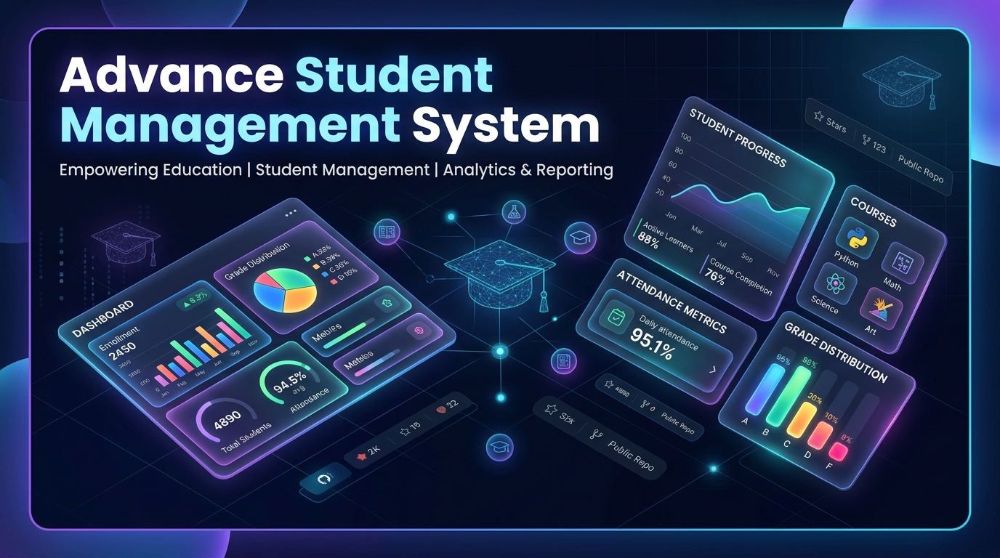
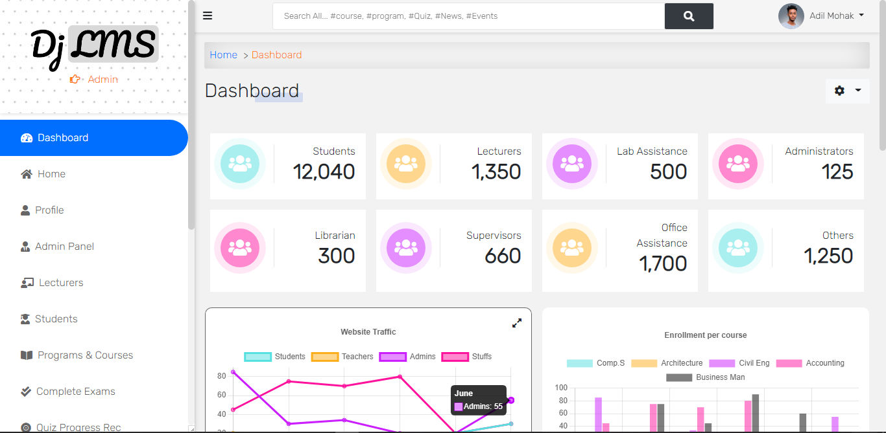

<div align="center">



# 🎓 Advance Student Management & Learning System

[](https://www.python.org/)
[](https://www.djangoproject.com/)
[](https://getbootstrap.com/)
[](LICENSE)
[]()

**A comprehensive, production-ready Learning Management System (LMS) and Student Information System (SIS) built with Django, featuring multi-role access control, dynamic grading algorithms, automated assessment engines, and PDF reporting.**

[Key Features](#-key-features) • [Quickstart Guide](#-quickstart-guide) • [Architecture](#-architecture--tech-stack) • [Security & RBAC](#-security--access-control) • [Contributing](#-contributing)

---

</div>

## 📌 Overview

The **Advance Student Management & Learning System** is an end-to-end institutional platform engineered to streamline educational administration. It bridges students, faculty, department heads, and parents into a unified portal featuring:

- Automated Academic Session & Semester workflows
- Dynamic GPA & CGPA calculation algorithms
- Real-time quiz evaluation and progress tracking
- Multi-channel document and video tutorial distribution
- Automated cryptographic and formatted PDF generation (Result Sheets, Transcripts, and Rosters)

<div align="center">
  
  <p><em>Real-Time Institutional Dashboard & Analytics</em></p>
</div>

---

## 🚀 Key Features

### 👥 Multi-Role Access Control (RBAC)
- **Superuser / Admin**: Central institutional management, staff assignment, activity audit logs, and system analytics.
- **Lecturers / Faculty**: Course allocation, student score submission, question bank authoring, and grade sheet generation.
- **Students**: Self-service course registration, video lectures, online examinations, real-time result scorecards, and semester tracking.
- **Department Heads**: Curricular management and semester-specific course offerings.
- **Parents**: Dedicated read-only portal to view student academic progress and attendance.

### 📚 Course & Curriculum Management
- Complete program structuring (Degrees, Levels, Semesters, Credit weights).
- Multimedia learning resources: course documents (PDF, DOCX, XLSX, PPTX) and embedded video tutorials.
- Dynamic enrollment and add/drop workflows for active semesters.

### 📝 Assessment & Examination Engine
- Interactive testing engine supporting Multiple Choice (MCQ) and Essay questions.
- Configurable settings: random question ordering, pass marks, single or multiple attempts, and draft modes.
- Instant automated scoring with real-time feedback and review.

### 📊 Academic Grading & Automated GPA/CGPA Calculation
- Standardized performance metrics: Assignment, Midterms, Quizzes, Attendance, and Final Exams.
- Continuous cumulative calculations ($GPA$ & $CGPA$) based on grade boundary thresholds ($A^+$ through $F$).
- Printable and downloadable official result scorecards rendered dynamically via **ReportLab**.

### 💳 Payments & Invoicing
- Invoice management with unique UUID tracking.
- Integrated payment gateways (Stripe, GoPay, and PayPal checkout stubs).

### 🌐 Internationalization (i18n)
- Multilingual interface support: **English**, **French**, **Spanish**, and **Russian** via `django-modeltranslation`.

---

## 🛠 Architecture & Tech Stack

| Layer | Technology |
| :--- | :--- |
| **Backend Framework** | Django 4.0.8 (Python 3.11 compatible) |
| **Database** | SQLite (Development) / PostgreSQL compatible (Production) |
| **Frontend & UI** | HTML5, CSS3, JavaScript, Bootstrap 5, FontAwesome 6 |
| **Admin Interface** | Django Jet Reboot dashboard suite |
| **API Layer** | Django REST Framework (DRF) |
| **PDF Generation** | ReportLab 4.0 & xhtml2pdf |
| **Asset Pipeline** | WhiteNoise 6.2 with gzip / Brotli manifest compression |
| **Payment Gateway** | Stripe SDK & GoPay SDK |

---

## 💻 Quickstart Guide

### Prerequisites
- **Python 3.10+** (Python 3.11 recommended)
- **Git**
- **pip** and **virtualenv**

### 1. Clone the Repository
```bash
git clone https://github.com/parvlabs/Advance-Student-Management-System.git
cd Advance-Student-Management-System/django-lms-main
```

### 2. Set Up Virtual Environment
```bash
# Windows
python -m venv .venv
.venv\Scripts\activate

# Linux / macOS
python3 -m venv .venv
source .venv/bin/activate
```

### 3. Install Dependencies
```bash
pip install -r requirements/base.txt
```

### 4. Configure Environment Variables
Copy `.env.example` to `.env` in `django-lms-main/`:
```bash
cp .env.example .env
```

Ensure your `.env` contains the required keys:
```env
DEBUG=True
SECRET_KEY=your-secure-secret-key-here
EMAIL_BACKEND=django.core.mail.backends.console.EmailBackend
EMAIL_HOST=smtp.gmail.com
EMAIL_PORT=587
EMAIL_USE_TLS=True
EMAIL_FROM_ADDRESS="Dj LMS <admin@example.com>"
EMAIL_HOST_USER="admin@example.com"
EMAIL_HOST_PASSWORD="your-email-password"
```

### 5. Apply Database Migrations
```bash
python manage.py migrate
```

### 6. Create Initial Academic Session & Superuser
```bash
# Create an administrative account
python manage.py createsuperuser

# (Optional) Initialize active session and semester via Django shell
python manage.py shell -c "from core.models import Session, Semester; s, _ = Session.objects.get_or_create(session='2026/2027', defaults={'is_current_session': True}); Semester.objects.get_or_create(semester='First', session=s, defaults={'is_current_semester': True});"
```

### 7. Collect Static Assets & Run
```bash
python manage.py collectstatic --noinput
python manage.py runserver
```

Open your browser at **[http://127.0.0.1:8000/](http://127.0.0.1:8000/)** to access the application.

---

## 📂 Project Directory Structure

```plaintext
Advance-Student-Management-System/
├── assets/                    # Project banners, mockups, and preview images
│   ├── banner.png
│   └── dashboard-preview.png
├── django-lms-main/           # Django LMS core backend application
│   ├── accounts/              # User profiles, authentication, RBAC decorators
│   ├── config/                # Project routing, WSGI/ASGI, i18n settings
│   ├── core/                  # Sessions, semesters, announcements, activity logs
│   ├── course/                # Curriculum, lecturer allocations, media uploads
│   ├── payments/              # Invoices & payment processors (Stripe, GoPay)
│   ├── quiz/                  # Quiz authoring, sittings, automated marking
│   ├── requirements/          # Base, local, and production dependency manifests
│   ├── result/                # Score recording, GPA calculations, PDF generation
│   ├── search/                # Unified cross-model search engine
│   ├── static/                # Vendor libraries, stylesheets, and JavaScript
│   ├── templates/             # Bootstrap 5 responsive UI templates
│   └── manage.py
├── .gitignore                 # Root Git exclusion rules
├── LICENSE                    # Project License
└── README.md                  # Project documentation
```

---

## 🔒 Security & Best Practices

- **Never commit `.env` or production credentials** to public version control.
- Ensure `DEBUG=False` and set explicit `ALLOWED_HOSTS` in production deployments.
- Enforce HTTPS and secure cookie handling:
  - `SESSION_COOKIE_SECURE = True`
  - `CSRF_COOKIE_SECURE = True`
  - `SECURE_SSL_REDIRECT = True`
- Validate and sanitize file uploads before writing to permanent storage.

---

## 🤝 Contributing

Contributions, issues, and feature requests are welcome!

1. Fork the Project
2. Create your Feature Branch (`git checkout -b feature/AmazingFeature`)
3. Commit your Changes (`git commit -m 'Add some AmazingFeature'`)
4. Push to the Branch (`git push origin feature/AmazingFeature`)
5. Open a Pull Request

---

## 📜 License

Distributed under the **MIT License**. See [`LICENSE`](LICENSE) for more information.

<div align="center">
  <sub>Developed by <b>Parveer Rao</b> & open-source contributors.</sub>
</div>
